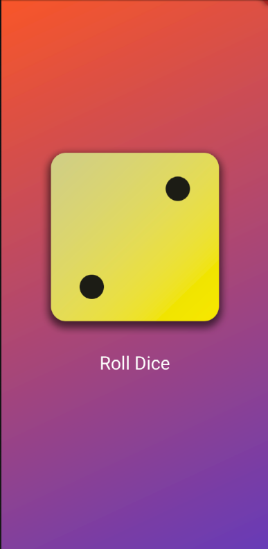
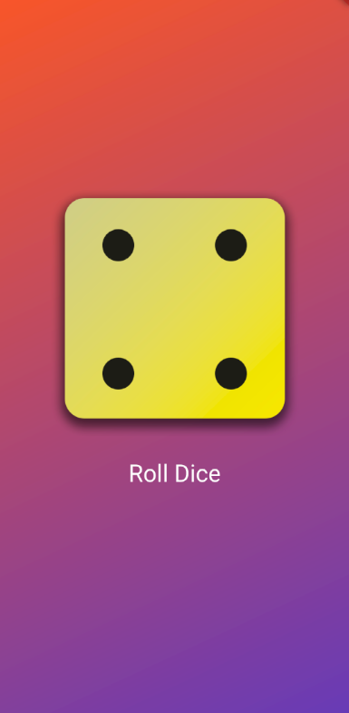
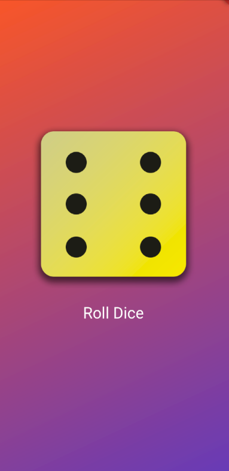

# 🎲 Dice Roller App

<div align="center">
  
  
  
  <br>
  
  
  
</div>

<p align="center">
  A beautifully crafted, minimal Flutter application that brings the classic dice rolling experience to your mobile device. Part of the comprehensive <code>flutter_mini_projects</code> series.
</p>

<div align="center">
  <a href="#-features">Features</a> •
  <a href="#-demo">Demo</a> •
  <a href="#-installation">Installation</a> •
  <a href="#-usage">Usage</a> •
  <a href="#-contributing">Contributing</a> •
  <a href="#-license">License</a>
</div>

---

## 📋 Table of Contents

- [🎯 Project Overview](#-project-overview)
- [✨ Features](#-features)
- [🎥 Demo](#-demo)
- [🧰 Tech Stack](#-tech-stack)
- [⚡ Quick Start](#-quick-start)
- [📦 Installation](#-installation)
- [🎮 Usage](#-usage)
- [📁 Project Structure](#-project-structure)
- [🔧 Configuration](#-configuration)
- [🧪 Testing](#-testing)
- [🤝 Contributing](#-contributing)
- [📄 License](#-license)
- [👨‍💻 Author](#-author)
- [🙏 Acknowledgments](#-acknowledgments)

---

## 🎯 Project Overview

The **Dice Roller App** is an interactive Flutter application that simulates the authentic experience of rolling a physical dice. This project serves as an excellent introduction to fundamental Flutter concepts while maintaining professional code quality and user experience standards.

### 🎓 Learning Objectives

This project demonstrates:
- **State Management**: Implementation of `StatefulWidget` for dynamic UI updates
- **Asset Management**: Proper handling and organization of image resources
- **User Interaction**: Responsive touch events and gesture handling
- **Random Number Generation**: Algorithmic simulation of dice mechanics
- **Material Design**: Adherence to Google's design principles

---

## ✨ Features

| Feature | Description |
|---------|-------------|
| 🎲 **Random Dice Rolling** | Authentic randomization with equal probability distribution |
| 🖼️ **High-Quality Assets** | Crisp, vectorized dice face images (1-6) |
| ⚡ **Instant Response** | Lightning-fast state updates with Flutter's hot reload |
| 📱 **Responsive Design** | Adaptive layout for various screen sizes and orientations |
| 🎨 **Material Design** | Clean, intuitive UI following Google's design guidelines |
| 🔄 **Smooth Animations** | Fluid transitions and visual feedback |
| 🚀 **Performance Optimized** | Minimal resource usage and fast rendering |

---

## 🎥 Demo

### 📱 Screenshots

<div align="center">
  
  
  
</div>

> **Note**: Screenshots showcase the app running on different dice states. The actual dice faces change randomly with each tap.

### 🎬 App in Action

```
🎲 Tap the dice → Random number generated → Dice face updates instantly
```

---

## 🧰 Tech Stack

<table>
  <tr>
    <th>Category</th>
    <th>Technology</th>
    <th>Version</th>
    <th>Purpose</th>
  </tr>
  <tr>
    <td><strong>Framework</strong></td>
    <td>Flutter</td>
    <td>^3.16.0</td>
    <td>Cross-platform UI framework</td>
  </tr>
  <tr>
    <td><strong>Language</strong></td>
    <td>Dart</td>
    <td>^3.2.0</td>
    <td>Programming language for Flutter</td>
  </tr>
  <tr>
    <td><strong>UI Library</strong></td>
    <td>Material Design</td>
    <td>Built-in</td>
    <td>Component library and design system</td>
  </tr>
  <tr>
    <td><strong>State Management</strong></td>
    <td>StatefulWidget</td>
    <td>Built-in</td>
    <td>Local state management</td>
  </tr>
</table>

---

## ⚡ Quick Start

Get the app running in under 2 minutes:

```bash
git clone https://github.com/Dakshin10/flutter_mini_projects.git
cd flutter_mini_projects/dice_roller_app
flutter pub get
flutter run
```

---

## 📦 Installation

### Prerequisites

Ensure you have the following installed:

- ✅ **Flutter SDK** (≥3.16.0) - [Installation Guide](https://flutter.dev/docs/get-started/install)
- ✅ **Dart SDK** (≥3.2.0) - Included with Flutter
- ✅ **IDE**: VS Code or Android Studio with Flutter plugin
- ✅ **Device**: Android/iOS simulator or physical device
- ✅ **Git** - For cloning the repository

### Step-by-Step Installation

1. **Clone the Repository**
   ```bash
   git clone https://github.com/Dakshin10/flutter_mini_projects.git
   ```

2. **Navigate to Project Directory**
   ```bash
   cd flutter_mini_projects/dice_roller_app
   ```

3. **Install Dependencies**
   ```bash
   flutter pub get
   ```

4. **Verify Installation**
   ```bash
   flutter doctor
   ```

5. **Run the Application**
   ```bash
   # For development
   flutter run
   
   # For release build
   flutter run --release
   ```

### Platform-Specific Setup

<details>
<summary><strong>🤖 Android Setup</strong></summary>

```bash
# Ensure Android SDK is installed
flutter doctor --android-licenses

# Run on Android device/emulator
flutter run -d android
```
</details>

<details>
<summary><strong>🍎 iOS Setup</strong></summary>

```bash
# macOS only - install iOS dependencies
sudo xcode-select --install
cd ios && pod install

# Run on iOS device/simulator
flutter run -d ios
```
</details>

---

## 🎮 Usage

### Basic Interaction

1. **Launch the App**: Open the Dice Roller App on your device
2. **Roll the Dice**: Tap anywhere on the dice image
3. **View Result**: Watch as the dice face changes to show a random number (1-6)
4. **Roll Again**: Tap repeatedly for continuous rolling

### Advanced Features

- **Multiple Rolls**: Each tap generates a truly random result
- **Visual Feedback**: Immediate visual response to user interaction
- **Accessibility**: Screen reader compatible for inclusive usage

---

## 📁 Project Structure

```
dice_roller_app/
├── 📁 assets/
│   └── 📁 images/
│       ├── 🖼️ dice-1.png          # Dice face showing 1
│       ├── 🖼️ dice-2.png          # Dice face showing 2
│       ├── 🖼️ dice-3.png          # Dice face showing 3
│       ├── 🖼️ dice-4.png          # Dice face showing 4
│       ├── 🖼️ dice-5.png          # Dice face showing 5
│       └── 🖼️ dice-6.png          # Dice face showing 6
├── 📁 lib/
│   ├── 📄 main.dart               # Application entry point
│   ├── 📄 dice_roller.dart        # Main dice roller widget
│   └── 📄 styled_text.dart        # Custom text styling widget
├── 📁 test/
│   └── 📄 widget_test.dart        # Unit and widget tests
├── 📁 screenshots/                # App screenshots for documentation
├── 📄 pubspec.yaml                # Project configuration and dependencies
├── 📄 analysis_options.yaml       # Dart analysis configuration
├── 📄 README.md                   # Project documentation
└── 📄 LICENSE                     # MIT License file
```

### Key Files Description

| File | Purpose |
|------|---------|
| `main.dart` | Application entry point and app configuration |
| `dice_roller.dart` | Core dice rolling logic and UI components |
| `styled_text.dart` | Reusable text styling components |
| `pubspec.yaml` | Dependencies, assets, and app metadata |

---

## 🔧 Configuration

### pubspec.yaml Configuration

```yaml
name: dice_roller_app
description: A professional dice rolling Flutter application
version: 1.0.0+1

environment:
  sdk: '>=3.2.0 <4.0.0'
  flutter: ">=3.16.0"

dependencies:
  flutter:
    sdk: flutter
  cupertino_icons: ^1.0.2

dev_dependencies:
  flutter_test:
    sdk: flutter
  flutter_lints: ^3.0.0

flutter:
  uses-material-design: true
  assets:
    - assets/images/
```

### Asset Configuration

Place dice images in the `assets/images/` directory with the following naming convention:
- `dice-1.png` through `dice-6.png`
- Recommended size: 200x200px
- Format: PNG with transparency support

---

## 🧪 Testing

### Running Tests

```bash
# Run all tests
flutter test

# Run with coverage
flutter test --coverage

# Run specific test file
flutter test test/widget_test.dart
```

### Test Structure

```
test/
├── widget_test.dart      # Widget testing
├── unit_test.dart        # Unit testing
└── integration_test.dart # Integration testing
```

---

## 🤝 Contributing

We welcome contributions! Please see our [Contributing Guidelines](CONTRIBUTING.md) for details.

### How to Contribute

1. **Fork** the repository
2. **Create** a feature branch (`git checkout -b feature/amazing-feature`)
3. **Commit** your changes (`git commit -m 'Add amazing feature'`)
4. **Push** to the branch (`git push origin feature/amazing-feature`)
5. **Open** a Pull Request

### Code Style

- Follow [Dart Style Guide](https://dart.dev/guides/language/effective-dart/style)
- Use meaningful variable and function names
- Add comments for complex logic
- Ensure all tests pass before submitting

---

## 📄 License

This project is licensed under the **MIT License** - see the [LICENSE](LICENSE) file for details.

```
MIT License

Copyright (c) 2024 Dakshin10

Permission is hereby granted, free of charge, to any person obtaining a copy
of this software and associated documentation files (the "Software")...
```

---

## 👨‍💻 Author

<div align="center">
  
  
  **Dakshin10**
  
  [](https://github.com/Dakshin10)
  [](https://www.linkedin.com/in/dakshin-raj-05b985279/)
 
</div>

---

## 🙏 Acknowledgments

- **Flutter Team** - For the amazing cross-platform framework
- **Material Design** - For the beautiful design system
- **Dart Community** - For continuous language improvements
- **Open Source Contributors** - For inspiration and best practices

---

<div align="center">
  <p>Made with ❤️ by <a href="https://github.com/Dakshin10">Dakshin10</a></p>
  <p>⭐ Star this repository if you found it helpful!</p>
</div>

---

## 📈 Project Stats

<div align="center">
  
</div>
