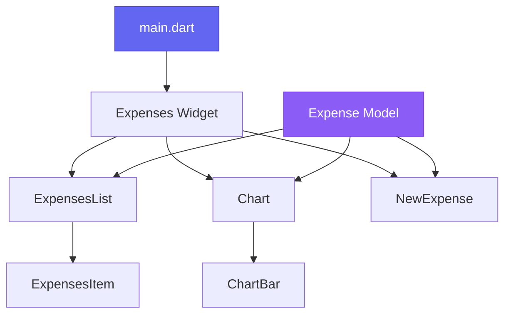

# 💰 Expense Tracker

<div align="center">


</div>

---

## 🎯 Overview

**Expense Tracker** is a modern, intuitive Flutter application designed to help you take control of your finances. With its clean Material Design interface, responsive layouts, and powerful visualization tools, managing your expenses has never been easier.


## ✨ Features

<table>
<tr>
<td width="50%">

### 📝 **Smart Expense Management**
- Add expenses with rich metadata
- Categorize with intuitive icons
- Date picker with validation
- Real-time form validation
- Swipe-to-delete with undo

</td>
<td width="50%">

### 📊 **Visual Analytics**
- Interactive bar charts
- Category-wise expense breakdown
- Dynamic color coding
- Responsive chart layouts
- Real-time data updates

</td>
</tr>
<tr>
<td>

### 🎨 **Modern Design**
- Material 3 Design System
- Adaptive color schemes
- Platform-specific dialogs
- Smooth animations
- Accessibility optimized

</td>
<td>

### 📱 **Cross-Platform**
- iOS & Android support
- Tablet-optimized layouts
- Platform-native components
- Consistent experience
- Offline functionality

</td>
</tr>
</table>

## 📱 App Preview

<div align="center">

### 🎨 **Beautiful Interface Highlights**

📊 **Dashboard View**  
*Interactive charts showing your spending patterns with smooth animations*

➕ **Smart Expense Form**  
*Responsive form with real-time validation and platform-native date pickers*

📋 **Organized History**  
*Clean expense list with swipe-to-delete and instant undo functionality*

🌗 **Adaptive Themes**  
*Seamless dark/light mode switching with carefully crafted color schemes*

📱 **Responsive Design**  
*Perfect layouts for phones, tablets, and different screen orientations*

</div>

### Key Visual Features:
- **Material 3 Design** with modern card layouts
- **Interactive bar charts** that scale with your data  
- **Smooth animations** for all user interactions
- **Consistent iconography** across all expense categories
- **Platform-specific dialogs** (iOS Cupertino / Android Material)

## 🚀 Quick Start

### Prerequisites

Ensure you have these installed:

- **Flutter SDK** `>=3.0.0`
- **Dart SDK** `>=2.17.0`
- **IDE**: VS Code, Android Studio, or IntelliJ
- **Device**: iOS Simulator, Android Emulator, or physical device

### ⚡ Installation

```bash
# 1️⃣ Clone the repository
git clone https://github.com/yourusername/expenses_tracker.git
cd expenses_tracker

# 2️⃣ Install dependencies
flutter pub get

# 3️⃣ Verify Flutter setup
flutter doctor

# 4️⃣ Run the app
flutter run
```

### 🎯 Build for Production

```bash
# Android APK
flutter build apk --release

# iOS (requires Mac)
flutter build ios --release

# Web
flutter build web
```

## 🏗️ Architecture

<div align="center">



</div>

### 📁 Project Structure

```
lib/
├── 🎯 main.dart                 # App entry point & theme configuration
├── 📁 models/
│   └── expense.dart             # Data models & business logic
├── 📁 widgets/
│   ├── expenses.dart            # Main screen coordinator
│   ├── new_expense.dart         # Expense creation form
│   ├── 📁 chart/
│   │   ├── chart.dart           # Analytics visualization
│   │   └── chart_bar.dart       # Chart components
│   └── 📁 expenses_list/
│       ├── expenses_list.dart   # List container
│       └── expenses_item.dart   # Individual expense cards
```

### 🔧 Key Components

| Component | Responsibility | Features |
|-----------|---------------|----------|
| `Expense Model` | Data structure & validation | UUID generation, date formatting |
| `NewExpense` | Form handling | Responsive layout, validation, platform dialogs |
| `Chart` | Data visualization | Dynamic scaling, theme adaptation |
| `ExpensesList` | List management | Dismissible items, animations |

## 🎨 Customization Guide

### Theme Customization

```dart
// Update colors in main.dart
var kColorScheme = ColorScheme.fromSeed(
  seedColor: Color(0xFF6366F1), // Indigo
);

var kDarkColorScheme = ColorScheme.fromSeed(
  brightness: Brightness.dark,
  seedColor: Color(0xFF0EA5E9), // Sky blue
);
```

### 📊 Adding New Categories

1. **Define the category**:
```dart
enum Category {
  food, travel, leisure, work, shopping, health // Add new categories
}
```

2. **Add corresponding icons**:
```dart
const categoryIcons = {
  Category.food: Icons.restaurant,
  Category.travel: Icons.flight,
  Category.leisure: Icons.movie,
  Category.work: Icons.business_center,
  Category.shopping: Icons.shopping_bag,      // New
  Category.health: Icons.local_hospital,     // New
};
```

### 💱 Currency Configuration

```dart
// In new_expense.dart - Update input field
decoration: const InputDecoration(
  prefixText: '\$ ',  // Change from 'Rs ' to your currency
  label: Text('Amount'),
),

// In expenses_item.dart - Update display
Text('\$${expense.amount.toStringAsFixed(2)}'),
```

## 📦 Dependencies

<table>
<tr>
<td><strong>Production</strong></td>
<td><strong>Purpose</strong></td>
<td><strong>Version</strong></td>
</tr>
<tr>
<td><code>flutter</code></td>
<td>Core framework</td>
<td>SDK</td>
</tr>
<tr>
<td><code>intl</code></td>
<td>Date formatting & localization</td>
<td>^0.18.0</td>
</tr>
<tr>
<td><code>uuid</code></td>
<td>Unique identifier generation</td>
<td>^3.0.7</td>
</tr>
</table>

## 🎯 Features Deep Dive

### 📊 Interactive Charts
- **Dynamic scaling** based on expense amounts
- **Category-wise breakdown** with visual indicators
- **Theme-aware colors** for consistency
- **Responsive layout** adapting to screen size

### 📱 Responsive Design
```dart
// Adaptive layout based on screen width
if (width >= 600)
  Row(children: [...])  // Tablet layout
else
  Column(children: [...])  // Mobile layout
```

### 🎨 Platform Integration
- **iOS**: Cupertino design elements and dialogs
- **Android**: Material Design 3 components
- **Automatic detection** of platform-specific features


## 👨‍💻 Author & Acknowledgments

<div align="center">

**Created with ❤️ by Dakshhi Raj**

</div>

---

<div align="center">
<sub>Built with 🚀 Flutter • Designed with 💜 for developers</sub>
</div>